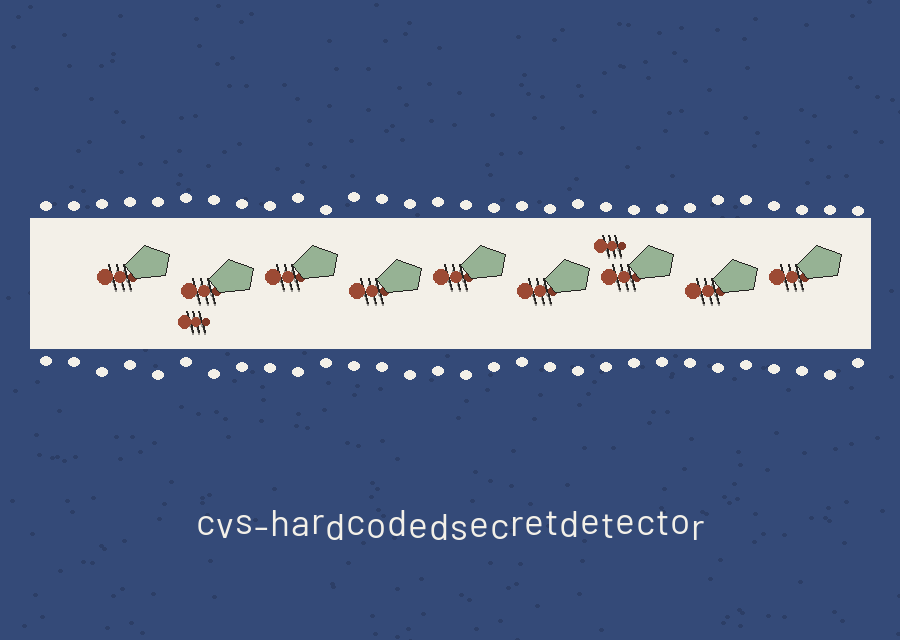
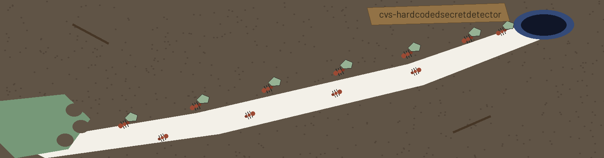

# cvs-hardcodedsecretdetector

Title block: the name above is set in Bonheur Royale in chimney brick on a white throat plate, with an evening blue rule beneath it and one small leaf fragment at the left of the first heading only, in the manner of a trail marker.

# cvs-HardcodedSecretDetector
A command-line tool that scans source code for hardcoded secrets, API keys, passwords, and other sensitive information using regular expressions, and, only when -e is passed, entropy analysis. It detects hardcoded secrets only; it does not check for SQL injection, XSS, or other vulnerability classes. Patterns cover private key block headers, GitHub tokens including the full ghp_ prefix, AWS access key IDs, password and token named assignments (password, pwd, secret, api_token, auth_token, access_token, and similar names), api_key assignments, aws_secret_access_key assignments, SQL connection strings, and JDBC credential URLs. Length based patterns are anchored to an assignment or label, so a plain run of letters is not reported, and one string is reported once, under a single type. Matched secret values are never printed or saved in clear: the console output and the -o output file carry the file, line, type, and context with the value replaced by [redacted], so a scan report is not itself a list of usable secrets. In directory mode the run prints how many files were scanned and how many were skipped as unreadable; if no file could be scanned, it says no scan was performed and exits 1 instead of reporting a clean result, matching single file mode, where an unreadable file also exits 1.

> Road note: values are never printed in clear. A finding carries the file, the line, the type, and the context, with the value replaced by [redacted], on the console and in the output file alike.

## Install
`git clone https://github.com/ShadowGuard-AI/cvs-hardcodedsecretdetector`

> Road note: entropy only when asked. Entropy analysis is off unless the -e flag is passed; a plain run is patterns only.

## Usage
`python3 main.py [-h] [-e] [-v] [-o OUTPUT] path`, run from the cloned directory. There is no executable or package by the repo name.

> Road note: one string counted once. Length based patterns are anchored to an assignment or label, and one string is reported once, under a single type.

## Parameters
- `path`: Path to the file or directory to scan. Required.
- `-h`: Show help message and exit
- `-e`: Enable entropy analysis for additional checks. Entropy analysis is off unless this flag is passed.
- `-v`: Enable verbose output (debug logging).
- `-o`: Path to output file to save results. Results are appended to the file, with secret values redacted the same way as the console output.

> Road note: a scan that read nothing is never clean. If no file could be scanned, the run says no scan was performed and exits 1 instead of reporting a clean result.

## License
Copyright (c) ShadowStrikeHQ

## Road notes, gathered on the highway

The controls of this re-skin read Scan the Path, Show Files Scanned and Skipped, and Show the Road Notes. Its headings read Hardcoded Secrets Only, Values Are Never Printed in Clear, Entropy Only When Asked, One String Counted Once, and A Scan That Read Nothing Is Never Clean. The licence line above stands as printed in the live README and is flagged, not corrected: it names ShadowStrikeHQ, which does not match the organisation in the install line. Beside it sits a separate fact. The repository LICENSE file carries the MIT License. Its holder line gives a pen name together with a single initial for the remaining name. That fact is recorded. The initial is not expanded.
